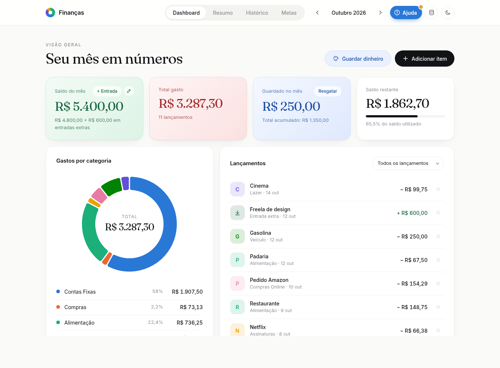
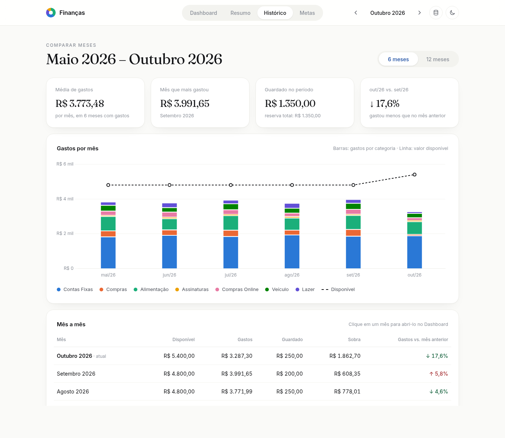
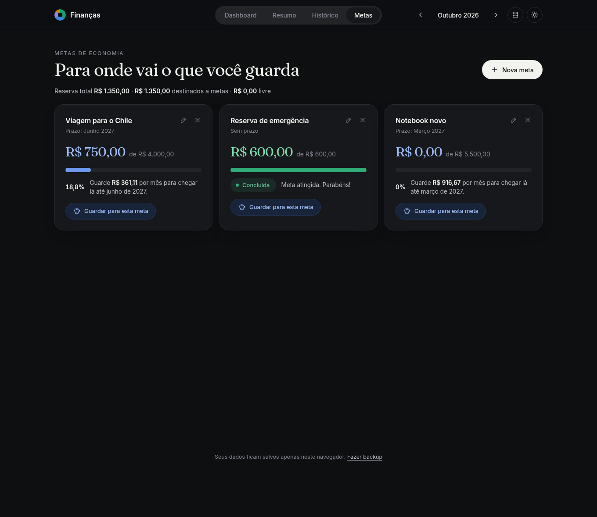

# Finanças

Controle financeiro pessoal simples, bonito e privado. Informe o saldo do mês, registre cada gasto e acompanhe para onde vai o seu dinheiro — tudo direto no navegador, sem cadastro e sem servidor.

**[Abrir o Finanças →](https://frankfspj.github.io/financas/)**



## Funcionalidades

- **Saldo do mês e entradas extras** — defina quanto você tem para gastar e some freelas, reembolsos ou vendas que aparecerem no meio do mês.
- **Gastos por categoria** — Contas Fixas, Compras, Alimentação, Assinaturas, Compras Online, Veículo, Lazer e Transporte, com gráfico de rosca e legenda (cores validadas para daltonismo).
- **Dinheiro guardado** — registre quanto guardou ou resgatou; o valor sai (ou volta) do saldo disponível sem contar como gasto.
- **Metas de economia** — crie metas com valor e prazo (ex.: *Viagem, R$ 4.000 até junho*), vincule o que você guarda a elas e veja quanto falta e quanto guardar por mês.
- **Resumo do mês** — situação do orçamento, projeção até o fim do mês, quanto ainda pode gastar por dia, maiores gastos e dicas automáticas. Pode ser impresso ou salvo em PDF.
- **Histórico** — compare os últimos 6 ou 12 meses em um gráfico de barras por categoria e em uma tabela mês a mês.
- **Backup** — exporte todos os seus dados em um arquivo `.json` e importe de volta quando precisar.
- **Central de ajuda** — botão **Ajuda** no topo com o passo a passo de cada função: como começar, atribuir dinheiro a metas, fazer backup e mais.
- **Modo escuro** — segue o tema do sistema ou a sua escolha.
- **Responsivo** — funciona no computador e no celular.

| Histórico | Metas (modo escuro) |
|---|---|
|  |  |

## Como usar

### Pelo navegador (recomendado)

Acesse **https://frankfspj.github.io/financas/** — não precisa instalar nada. Na dúvida, clique em **Ajuda** no topo da página.

### Localmente

1. Baixe o projeto: botão **Code → Download ZIP** (ou `git clone https://github.com/frankfspj/financas.git`).
2. Extraia a pasta e abra o arquivo `index.html` no navegador.

> O gráfico (Chart.js) e as fontes são carregados da internet. Sem conexão o site continua funcionando, mas sem os gráficos.

## Seus dados

- Tudo fica salvo **apenas no seu navegador** (`localStorage`). Nada é enviado para nenhum servidor.
- Os dados **não sincronizam** entre navegadores ou aparelhos, e são apagados se você limpar os dados de navegação.
- Por isso, **faça backup de vez em quando**: clique no ícone de banco de dados no topo da página → *Exportar backup*. Para restaurar (ou levar os dados para outro aparelho), use *Importar backup*.
- Um ponto amarelo aparece no ícone de backup quando você está há mais de 30 dias sem exportar.

## Estrutura

```
financas/
├── index.html      # estrutura da página e janelas (modais)
├── css/style.css   # visual, temas claro e escuro
├── js/app.js       # lógica, cálculos, gráficos e armazenamento
└── docs/           # imagens deste README
```

Feito com HTML, CSS e JavaScript puros, mais [Chart.js](https://www.chartjs.org/) para os gráficos. Não há etapa de build: basta editar os arquivos e recarregar a página.
